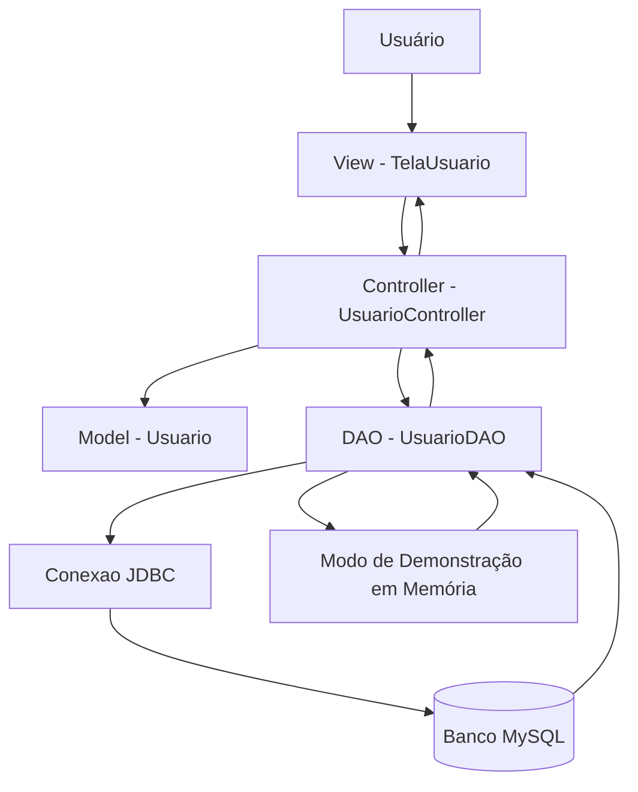

# UserCore — Sistema de Gestão de Usuários

**Sistema desktop para cadastro, consulta, edição e exclusão de usuários**, desenvolvido em Java com interface gráfica Swing, arquitetura MVC e persistência de dados em MySQL por meio de JDBC.

O UserCore permite administrar registros de usuários em uma interface visual, com formulário de cadastro, tabela de consulta, pesquisa em tempo real e validação dos dados informados. A aplicação também possui um modo de demonstração em memória, utilizado quando o banco MySQL não está disponível.

> **Objetivo acadêmico:** demonstrar programação orientada a objetos, desenvolvimento de interfaces gráficas com Java Swing, tratamento de eventos, arquitetura MVC, operações CRUD e integração com banco de dados relacional utilizando JDBC.

---

## Sumário

- [1. Visão Geral e Problema do Mundo Real](#-1-visão-geral-e-problema-do-mundo-real)
- [2. Objetivos do Projeto](#-2-objetivos-do-projeto)
- [3. Arquitetura do Sistema](#-3-arquitetura-do-sistema)
- [4. Funcionalidades](#-4-funcionalidades)
- [5. Operações CRUD e Persistência](#-5-operações-crud-e-persistência)
- [6. Validação e Tratamento de Eventos](#-6-validação-e-tratamento-de-eventos)
- [7. Interface Gráfica](#-7-interface-gráfica)
- [8. Tecnologias Utilizadas](#-8-tecnologias-utilizadas)
- [9. Banco de Dados](#-9-banco-de-dados)
- [10. Como Executar o Projeto](#-10-como-executar-o-projeto)
- [11. Estrutura de Diretórios](#-11-estrutura-de-diretórios)
- [12. Conceitos Aplicados](#-12-conceitos-aplicados)
- [13. Considerações Finais](#-13-considerações-finais)

---

## 1. Visão Geral e Problema do Mundo Real

Sistemas de gestão de usuários são utilizados em empresas, instituições e aplicações que precisam manter informações cadastrais organizadas e acessíveis. Mesmo em cenários simples, o cadastro manual ou a ausência de uma estrutura centralizada pode dificultar a consulta, a atualização e a manutenção dos registros.

O **UserCore** foi desenvolvido para representar esse cenário por meio de uma aplicação desktop. O sistema reúne em uma única janela os campos de identificação do usuário, as ações de manutenção dos registros e uma tabela com os dados cadastrados.

Cada registro contempla as seguintes informações:

- **ID:** identificador numérico gerado automaticamente pelo banco de dados.
- **Nome completo:** nome do usuário cadastrado.
- **E-mail:** endereço eletrônico associado ao registro.

A aplicação permite incluir novos usuários, selecionar registros existentes, alterar informações, excluir cadastros e filtrar a listagem por nome ou e-mail.

### Por que esse projeto é relevante?

- **Organização de dados:** centraliza os registros em uma tabela de consulta.
- **Manutenção cadastral:** oferece operações de inclusão, edição e exclusão.
- **Facilidade de uso:** reúne formulário, pesquisa e listagem em uma interface gráfica.
- **Persistência:** utiliza MySQL para armazenar os registros entre execuções.
- **Arquitetura modular:** separa interface, regras de interação, modelo de dados e acesso ao banco.
- **Continuidade de demonstração:** disponibiliza dados em memória quando a conexão com o MySQL não está disponível.

---

## 2. Objetivos do Projeto

O projeto foi concebido para aplicar conceitos de programação orientada a objetos e desenvolvimento de aplicações desktop conectadas a banco de dados.

### Objetivos principais

1. Desenvolver uma interface gráfica desktop utilizando Java Swing.
2. Implementar as operações de cadastro, consulta, atualização e exclusão de usuários.
3. Aplicar o padrão arquitetural MVC para separar responsabilidades.
4. Integrar a aplicação a um banco de dados MySQL por meio de JDBC.
5. Utilizar `PreparedStatement` para executar comandos SQL parametrizados.
6. Validar os campos do formulário antes de realizar operações.
7. Implementar eventos de interface por meio de listeners.
8. Disponibilizar pesquisa em tempo real por nome ou e-mail.
9. Criar componentes visuais reutilizáveis para padronizar a interface.
10. Implementar um modo de demonstração em memória para situações em que o MySQL esteja indisponível.

---

## 3. Arquitetura do Sistema

O UserCore utiliza o padrão **MVC (Model-View-Controller)**, organizando o código em três responsabilidades principais: representação dos dados, interface gráfica e controle das ações do usuário.

O projeto também possui um módulo de conexão com o banco de dados e uma classe DAO responsável pelas operações de persistência.

### Visão simplificada da arquitetura



### Responsabilidades das camadas

| Camada / Módulo | Responsabilidade |
|---|---|
| `view/` | Construção da janela, formulário, tabela e componentes visuais. |
| `controller/` | Tratamento dos eventos, validações e coordenação das operações solicitadas pelo usuário. |
| `model/Usuario.java` | Representação de um usuário, com ID, nome e e-mail. |
| `model/UsuarioDAO.java` | Operações de persistência, consultas e modo de demonstração em memória. |
| `conexao/Conexao.java` | Configuração e estabelecimento da conexão JDBC com o MySQL. |
| `view/components/` | Componentes visuais reutilizáveis, como botões, campos, tabela, cartões e indicadores. |
| `Main.java` | Ponto de entrada da aplicação e inicialização da interface Swing. |

### Como funciona o fluxo MVC?

1. O usuário interage com a tela (`View`).
2. A interação gera um evento, tratado pelo controlador (`Controller`).
3. O controlador valida os dados e solicita a operação necessária ao DAO.
4. O DAO executa a operação no MySQL ou utiliza o modo de demonstração em memória.
5. O resultado retorna ao controlador, que atualiza a interface.

Essa divisão evita concentrar toda a lógica em uma única classe e facilita a manutenção do projeto.

---

## 4. Funcionalidades

O sistema reúne os recursos necessários para a administração básica dos registros de usuários.

### 4.1 Cadastro de usuários

Permite inserir um novo registro por meio dos campos de nome e e-mail.

- O nome é obrigatório e deve possuir pelo menos dois caracteres.
- O e-mail é obrigatório e passa por uma validação de formato.
- O ID é gerado automaticamente pelo banco de dados no modo MySQL.
- Após o cadastro, o formulário é limpo e a tabela é atualizada.

### 4.2 Consulta e listagem

Apresenta os usuários cadastrados em uma tabela com as colunas:

| Coluna | Descrição |
|---|---|
| ID | Identificador do registro. |
| Nome Completo | Nome informado no cadastro. |
| E-mail Cadastrado | Endereço eletrônico do usuário. |

Os registros são apresentados em ordem crescente de ID.

### 4.3 Edição de usuários

Ao selecionar uma linha da tabela, os dados correspondentes são carregados no formulário.

O sistema alterna para o modo de edição, permitindo alterar o nome e o e-mail do usuário selecionado. A atualização é realizada com base no ID do registro.

### 4.4 Exclusão de usuários

Permite remover um cadastro selecionado.

Antes da exclusão, o sistema apresenta uma janela de confirmação, informando o nome e o ID do usuário que será removido.

### 4.5 Pesquisa em tempo real

O campo de busca permite filtrar os registros enquanto o usuário digita.

- A pesquisa considera nome e e-mail.
- A comparação não diferencia letras maiúsculas e minúsculas.
- O contador informa a quantidade de registros exibidos e, quando aplicável, o total cadastrado.

### 4.6 Atualização da listagem

O botão **Recarregar** solicita uma nova listagem e tenta restabelecer a conexão com o banco de dados antes de atualizar os registros.

### 4.7 Modo de demonstração em memória

Quando o MySQL não está acessível durante a inicialização ou ocorre uma falha de conexão durante uma operação, o DAO ativa um modo de contingência em memória.

Nesse modo:

- A aplicação continua permitindo demonstrar as operações de cadastro, edição, exclusão e listagem.
- São carregados três registros de demonstração iniciais.
- Os novos registros ficam armazenados apenas na memória da execução atual.
- Os dados desse modo não são persistidos no MySQL.

**Importante:** o modo em memória é destinado à demonstração. Os dados cadastrados nele podem ser perdidos ao encerrar a aplicação.

---

## 5. Operações CRUD e Persistência

CRUD é a sigla para as quatro operações básicas de manipulação de dados:

| Operação | Significado | Implementação no UserCore |
|---|---|---|
| **Create** | Criar um registro. | `inserir()` |
| **Read** | Consultar registros. | `listar()` |
| **Update** | Atualizar um registro. | `atualizar()` |
| **Delete** | Excluir um registro. | `excluir()` |

### Comandos SQL utilizados

**Inserção:**

```sql
INSERT INTO usuario (nome, email)
VALUES (?, ?);
```

**Consulta:**

```sql
SELECT id, nome, email
FROM usuario
ORDER BY id ASC;
```

**Atualização:**

```sql
UPDATE usuario
SET nome = ?, email = ?
WHERE id = ?;
```

**Exclusão:**

```sql
DELETE FROM usuario
WHERE id = ?;
```

O projeto utiliza `PreparedStatement` para parametrizar os comandos de inserção, atualização e exclusão. Na consulta geral, utiliza `Statement`.

Após a inserção, o sistema recupera a chave gerada pelo banco de dados por meio de `getGeneratedKeys()`.

### Tratamento dos recursos JDBC

As operações que utilizam conexão, comandos e resultados empregam blocos `try-with-resources` quando aplicável, permitindo que os recursos sejam fechados automaticamente ao final da operação.

---

## 6. Validação e Tratamento de Eventos

A interação com a interface é controlada por eventos do Java Swing.

### 6.1 Eventos dos botões

O controlador registra listeners para os botões da tela:

| Componente | Ação |
|---|---|
| Salvar Usuário | Valida os campos e cadastra um novo usuário. |
| Salvar Alterações | Atualiza o registro selecionado. |
| Excluir | Solicita confirmação e remove o usuário. |
| Limpar Campos | Limpa o formulário e retorna ao modo de cadastro. |
| Recarregar | Tenta reconectar ao banco e atualiza a listagem. |

As ações são registradas por meio de `addActionListener()`.

### 6.2 Seleção de registros

A tabela possui um listener de seleção. Quando uma linha é selecionada, o controlador identifica o registro correspondente e preenche os campos do formulário.

O sistema também converte o índice da linha visual para o índice do modelo da tabela, permitindo que a seleção continue correta mesmo quando há filtros ativos.

### 6.3 Validação dos dados

Antes de cadastrar ou atualizar um usuário, o controlador verifica:

- Se o nome foi preenchido.
- Se o nome possui pelo menos dois caracteres.
- Se o e-mail foi preenchido.
- Se o e-mail corresponde ao padrão de formato esperado.

Quando algum campo é inválido, a operação é interrompida e uma mensagem é exibida na interface.

### 6.4 Feedback ao usuário

O sistema utiliza mensagens visuais para informar o resultado das operações, incluindo confirmações de sucesso, avisos e erros.

---

## 7. Interface Gráfica

A interface foi desenvolvida com **Java Swing**, utilizando uma janela principal organizada em áreas funcionais.

### Organização visual

- **Cabeçalho:** apresenta o título do sistema, campo de pesquisa, botão de recarga e indicador de conexão.
- **Formulário:** reúne os campos de ID, nome e e-mail, além dos botões de ação.
- **Tabela:** exibe os usuários cadastrados e permite selecionar registros.
- **Rodapé:** apresenta o status da aplicação e uma orientação de uso.

### Componentes e recursos utilizados

| Componente / Recurso | Finalidade |
|---|---|
| `JFrame` | Janela principal da aplicação. |
| `JPanel` | Agrupamento e organização dos elementos da interface. |
| `JLabel` | Exibição de títulos, rótulos e informações. |
| `JScrollPane` | Área de rolagem da tabela. |
| `JTable` | Exibição dos registros de usuários. |
| `DefaultTableModel` | Modelo de dados utilizado pela tabela. |
| `JOptionPane` | Confirmação de exclusão. |
| `BorderLayout`, `GridLayout`, `FlowLayout` e `BoxLayout` | Organização dos componentes. |
| `TableRowSorter` e `RowFilter` | Ordenação e filtragem visual dos registros. |

### Componentes visuais personalizados

O projeto possui componentes próprios no pacote `view/components/`:

- `ModernButton`: botão com estilos visuais definidos pelo projeto.
- `ModernCard`: painel com aparência de cartão.
- `ModernTable`: tabela com personalização visual.
- `ModernTextField`: campo de texto com estilo e suporte a texto de orientação.
- `NotificationBanner`: exibição de mensagens de feedback.
- `StatusBadge`: indicador visual do estado da conexão.
- `UIConstants`: centralização de cores, fontes e constantes de interface.

---

## 8. Tecnologias Utilizadas

| Tecnologia | Utilização |
|---|---|
| **Java** | Linguagem principal e implementação da lógica da aplicação. |
| **Java Swing** | Construção da interface gráfica desktop. |
| **AWT** | Recursos de layout, cores, dimensões e eventos utilizados pelo Swing. |
| **JDBC** | Comunicação entre a aplicação Java e o banco de dados. |
| **MySQL** | Banco de dados relacional para persistência dos usuários. |
| **MySQL Connector/J 9.2.0** | Driver JDBC utilizado para conectar ao MySQL. |
| **PreparedStatement** | Execução de comandos SQL parametrizados. |
| **ResultSet** | Leitura dos registros retornados pelas consultas. |
| **IntelliJ IDEA** | Ambiente de desenvolvimento identificado no projeto. |
| **Git e GitHub** | Podem ser utilizados para versionamento e hospedagem do código-fonte. |

---

## 9. Banco de Dados

O projeto utiliza o MySQL e trabalha com o banco de dados `mvc_crud`, contendo a tabela `usuario`.

### Estrutura da tabela

| Campo | Tipo | Regra |
|---|---|---|
| `id` | `INT` | Chave primária com incremento automático. |
| `nome` | `VARCHAR(100)` | Obrigatório (`NOT NULL`). |
| `email` | `VARCHAR(100)` | Obrigatório (`NOT NULL`). |

### Script SQL

O arquivo `banco.sql`, localizado na raiz do projeto, contém a criação do banco e da tabela:

```sql
CREATE DATABASE mvc_crud;
USE mvc_crud;

CREATE TABLE usuario (
    id INT AUTO_INCREMENT PRIMARY KEY,
    nome VARCHAR(100) NOT NULL,
    email VARCHAR(100) NOT NULL
);
```

A classe `conexao/Conexao.java` contém as configurações de conexão:

- **Servidor:** `localhost`
- **Porta:** `3306`
- **Banco:** `mvc_crud`
- **Usuário configurado:** `root`
- **Senha configurada no código:** vazia

Ajuste essas configurações em `Conexao.java` de acordo com o ambiente local antes de executar o sistema.

---

## 10. Como Executar o Projeto

### Pré-requisitos

Antes de iniciar, verifique se o ambiente possui:

- JDK instalado e configurado.
- MySQL Server instalado e em execução, para utilizar a persistência no banco.
- IntelliJ IDEA ou outra IDE compatível com projetos Java.
- MySQL Connector/J 9.2.0, disponibilizado na pasta `lib/`.

### 10.1. Preparar o banco de dados

Inicie o servidor MySQL e execute o conteúdo do arquivo `banco.sql` em um cliente MySQL, como MySQL Workbench ou terminal.

O script cria o banco `mvc_crud` e a tabela `usuario`.

### 10.2. Configurar a conexão

Abra o arquivo:

```text
src/conexao/Conexao.java
```

Confira os valores de servidor, porta, nome do banco, usuário e senha. Eles devem corresponder à configuração do MySQL instalado na máquina.

### 10.3. Abrir o projeto na IDE

1. Extraia o conteúdo do arquivo ZIP.
2. Abra a pasta `UserCore` no IntelliJ IDEA.
3. Verifique se o JDK do projeto está configurado.
4. Adicione o arquivo `lib/mysql-connector-j-9.2.0.jar` às bibliotecas do projeto, caso a IDE ainda não o reconheça.
5. Localize a classe `src/Main.java`.

### 10.4. Executar a aplicação

Execute o método `main()` da classe `Main`.

A aplicação inicializa a interface Swing, configura a aparência do sistema, cria o controlador e exibe a janela principal.

**Execução sem MySQL:** se o banco não estiver disponível, o sistema tenta iniciar em modo de demonstração em memória. Nesse modo, as operações são temporárias e não ficam salvas após o encerramento da aplicação.

---

## 11. Estrutura de Diretórios

```text
UserCore/
│
├── banco.sql
├── lib/
│   └── mysql-connector-j-9.2.0.jar
│
├── src/
│   ├── Main.java
│   │
│   ├── conexao/
│   │   └── Conexao.java
│   │
│   ├── controller/
│   │   └── UsuarioController.java
│   │
│   ├── model/
│   │   ├── Usuario.java
│   │   └── UsuarioDAO.java
│   │
│   └── view/
│       ├── TelaUsuario.java
│       │
│       └── components/
│           ├── ModernButton.java
│           ├── ModernCard.java
│           ├── ModernTable.java
│           ├── ModernTextField.java
│           ├── NotificationBanner.java
│           ├── StatusBadge.java
│           └── UIConstants.java
│
└── README.md
```

---

## 12. Conceitos Aplicados

O desenvolvimento do UserCore reúne conceitos de programação, interfaces gráficas, persistência e organização de software.

### Programação orientada a objetos

- Classes e objetos.
- Encapsulamento de atributos.
- Métodos getters e setters.
- Construtores.
- Separação de responsabilidades.

### Desenvolvimento de interfaces gráficas

- Java Swing e componentes AWT.
- Containers e gerenciadores de layout.
- Formulários e tabelas.
- Componentes visuais personalizados.
- Barras de rolagem.
- Eventos e interfaces listeners.

### Banco de dados e persistência

- Banco de dados relacional.
- Conexão JDBC.
- `DriverManager` e `Connection`.
- `Statement` e `PreparedStatement`.
- `ResultSet`.
- Comandos SQL de inserção, consulta, atualização e exclusão.
- Tratamento de exceções com `SQLException`.

### Arquitetura e organização

- Padrão MVC.
- Padrão DAO (*Data Access Object*).
- Separação entre interface, controle e persistência.
- Reutilização de componentes.
- Organização modular do código.

### Experiência do usuário

- Validação de formulários.
- Feedback visual.
- Confirmação antes de excluir registros.
- Pesquisa em tempo real.
- Atualização dinâmica da tabela.

---

## 13. Considerações Finais

O **UserCore — Sistema de Gestão de Usuários** demonstra a construção de uma aplicação desktop em Java capaz de administrar registros cadastrais por meio de uma interface gráfica integrada a um banco de dados relacional.

Ao combinar Java Swing, JDBC, MySQL e a arquitetura MVC, o projeto oferece uma aplicação prática para estudar a comunicação entre interface, regras de controle e camada de persistência.

**Principais áreas de conhecimento demonstradas:**

- Programação orientada a objetos com Java.
- Desenvolvimento desktop com Swing.
- Gerenciamento de eventos com listeners.
- Arquitetura MVC.
- Padrão DAO.
- Operações CRUD.
- Integração com MySQL por JDBC.
- Validação e tratamento de dados.
- Componentização e organização de interfaces.

---

### Aviso de uso

Este projeto tem finalidade acadêmica e demonstrativa. O sistema realiza o gerenciamento básico de registros de usuários (ID, nome e e-mail). A implementação apresentada não contempla autenticação, controle de permissões, gerenciamento de senhas ou administração de sessões de acesso.

Para utilização em um ambiente real, seria necessário implementar mecanismos adicionais de segurança, controle de acesso, proteção de credenciais e políticas de privacidade.

---

**Desenvolvido para fins acadêmicos e de estudo em Java, interfaces gráficas, banco de dados e engenharia de software.**
